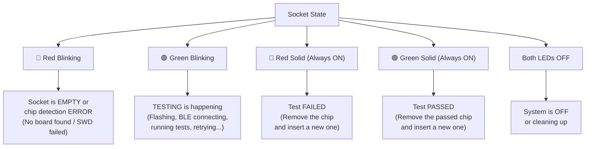
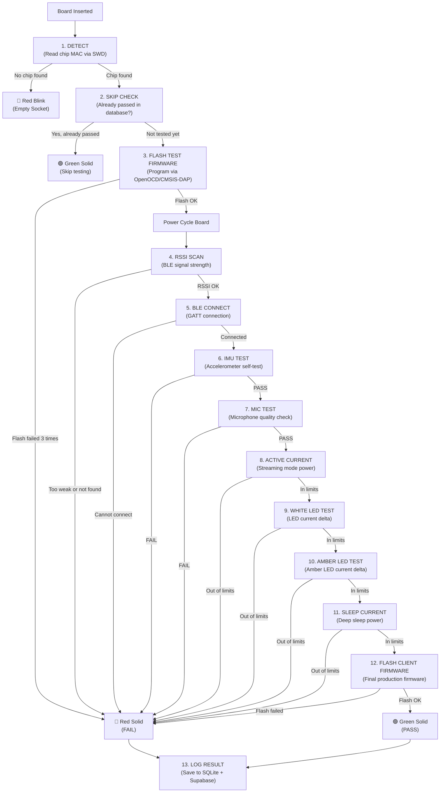

# NEO Test Jig - Project Guide

This document explains the entire NEO Test Jig project in simple language. It covers GPIO pin usage, what each Python file does, LED patterns, and all the tests in the main test script.

---

## 1. GPIO Pin Table (Raspberry Pi BCM Pin Numbers)

| GPIO Pin | Use | Comments |
|----------|-----|----------|
| **4** | Socket 3 Green LED | Solid ON = Pass, Blinking = Testing |
| **13** | Board 1 Power Control | HIGH = Board 1 power ON, LOW = power OFF |
| **14** | Start Button (jig_button.py) | Press to start the test process (Active-High with pull-down) |
| **15** | Stop Button (jig_button.py) | Press to stop/quit the test process (Active-High with pull-down) |
| **17** | Socket 3 Red LED | Solid ON = Fail, Blinking = Empty/Error |
| **18** | Start Button (all_test_mux_remove.py) | Alternative Start pin used in main test script |
| **22** | Socket 2 Green LED | Solid ON = Pass, Blinking = Testing |
| **23** | Socket 2 Red LED / Stop Button | Red LED for Socket 2, also used as Stop pin in main test script |
| **24** | Socket 1 Green LED | Solid ON = Pass, Blinking = Testing |
| **25** | Socket 1 Red LED | Solid ON = Fail, Blinking = Empty/Error |
| **26** | Board 3 Power Control | HIGH = Board 3 power ON, LOW = power OFF |
| **27** | Board 2 Power Control | HIGH = Board 2 power ON, LOW = power OFF |

> **Note:** All GPIO pins use BCM numbering. LEDs are Active-High (GPIO HIGH turns the LED ON). Buttons are Active-High (pressing the button sends 3.3V / HIGH to the GPIO pin).

---

## 2. Python Files Overview

| File Name | What It Does |
|-----------|--------------|
| `all_test_mux_remove.py` | **Main test script.** Runs the full automated test on up to 3 boards (sockets). Tests include: chip detection, firmware flashing, BLE connection, RSSI, IMU, Microphone, LED, current measurement (active & sleep), and final firmware programming. Saves results to SQLite database with optional Supabase cloud sync. |
| `jig_button.py` | **Button daemon.** Watches the physical Start and Stop buttons on the jig. Pressing Start launches the main test script; pressing Stop gracefully kills it. Runs as a background service. |
| `jig_db.py` | **Database module.** Manages local SQLite database storage and automatic background sync to Supabase (cloud PostgreSQL). Handles saving test results, checking if a MAC already passed, and batch-uploading pending records when internet is available. |
| `main.py` | **Manual measurement tool.** Runs current and/or voltage measurements on a single board socket. Used for manual validation and debugging of the power measurement hardware. |
| `ADS122C04.py` | **ADC driver.** Low-level I2C driver for the ADS122C04 24-bit analog-to-digital converter chip. Handles register reads/writes, configuration, and raw data conversion. |
| `currentMeasurementModule.py` | **Current measurement.** Uses the ADS122C04 ADC (at I2C address 0x40) with a shunt resistor and amplifier to measure the current consumed by the board under test. Supports multiple gain ranges for micro-amp to milli-amp accuracy. |
| `voltageMeasurementModule.py` | **Voltage measurement.** Uses a second ADS122C04 ADC (at I2C address 0x41) to measure supply rail voltages (V_charging) through resistive dividers. Each board socket has its own ADC input channel. |
| `mic_test.py` | **Microphone test driver.** Connects to the DUT (Device Under Test) over BLE, sends AT commands to capture audio, and transfers the recorded samples for analysis. Provides the DutSession class used by the main test script. |
| `mic_qc.py` | **Microphone quality checker.** Plays a stimulus tone through a speaker, captures audio from the DUT mic, and checks THD (Total Harmonic Distortion) and SNR (Signal-to-Noise Ratio) against calibrated limits. Can generate limit files from calibration runs. |
| `neo_jig_gui.py` | **Remote GUI (runs on a PC).** Tkinter-based graphical interface that connects to the Raspberry Pi over SSH to monitor and control the test jig remotely. Shows real-time status of all 3 sockets with color-coded pass/fail indicators. |
| `neo_pi_gui.py` | **Local GUI (runs on Raspberry Pi).** Lightweight Tkinter GUI that runs directly on the Pi. Shows all 3 sockets, 11 test steps per socket, database viewer, and hardware check — all without needing SSH or a network. |
| `recover_all.sh` | **Socket recovery utility.** Powers ON and recovers (unlocks & mass-erases via `nrf52_recover`) all 3 sockets or a selected socket using CMSIS-DAP probes, then powers OFF the board. |
| `flash_test_firmware.sh` | **Test firmware flashing utility.** Powers ON and flashes `neo_test_firmware.hex` to all 3 boards using OpenOCD and CMSIS-DAP (with automatic recovery retry if locked), then powers OFF the board. |
| `neo_jig_dharmisha.py` | **Legacy single-board test script.** An older version of the test jig code that tests one module at a time. Kept for reference. |
| `sim.py` | **Simulator.** Generates simulated ADC output for testing current measurement code without physical hardware. |
| `fit.py` | **Calibration curve fitter.** Takes known current vs. measured current data points and fits a linear calibration equation for the current measurement module. |
| `fit_case2.py` | **Calibration fitter (Case 2).** Similar to `fit.py` but for a different gain range (Case 2) of the current measurement circuit. |
| `dump_neo_test.py` | **Excel dump utility.** Reads an `.xlsx` test results spreadsheet and prints its contents to the terminal for quick inspection. |
| `temp_script.py` | **Temporary/debug script.** A working copy of the current measurement module used for development and experimentation. |

### Non-Python Files

| File Name | What It Does |
|-----------|--------------|
| `limits.json` | Microphone test pass/fail limit thresholds (THD, SNR, tone levels). Generated by `mic_qc.py --calibrate`. |
| `gatt_handles.json` | Cached BLE GATT characteristic handles. Saves time by skipping service discovery on subsequent test runs. |
| `supabase_schema.sql` | SQL commands to create the cloud database table in Supabase. Copy-paste into the Supabase SQL Editor. |
| `jig.log` | Live log file from the test script. The GUI reads this to show real-time progress. |
| `NEO_JIG_RESULTS.csv` | Legacy CSV output for test results (database is now used instead). |

---

## 3. LED Button Patterns

The test jig has **6 LEDs** — one Green and one Red for each of the 3 board sockets. Here is what each pattern means:

### Simple Summary

| LED Pattern | What It Means | What To Do |
|-------------|---------------|------------|
| 🔴 **Red Blinking** | Socket is empty or there is a detection error | Insert a board into the socket |
| 🟢 **Green Blinking** | Testing is in progress (flashing, connecting, measuring) | Wait — do not touch the board |
| 🔴 **Red Solid** | The board has FAILED all tests | Remove the failed board, insert a new one |
| 🟢 **Green Solid** | The board has PASSED all tests | Remove the passed board, insert a new one to test |
| **Both OFF** | System is shut down or cleaning up | — |

> **Blink Speed:** LEDs blink at 0.5-second intervals (0.5s ON, 0.5s OFF).  
> **LED Polarity:** Active-High — GPIO HIGH = LED ON, GPIO LOW = LED OFF.

---

## 4. All Tests in `all_test_mux_remove.py`

The main test script runs the following tests **in order** on each board. If any test fails, the board is marked FAIL and testing stops for that board.

### Test Flow Overview

### Detailed Test Descriptions

#### Test 1: DETECT (Chip Detection)
- **What it does:** Powers on the board socket and uses OpenOCD with a CMSIS-DAP debugger to read the chip's unique MAC address from its FICR (Factory Information Configuration Registers) via SWD (Serial Wire Debug).
- **Pass condition:** A valid MAC address is read from the chip.
- **Retries:** 3 attempts with 1-second pauses.
- **If it fails:** The socket shows Red Blink (empty or unresponsive chip). If the chip is APPROTECT-locked, the script tries to recover (unlock + erase) automatically.

#### Test 2: SKIP CHECK (Database Lookup)
- **What it does:** Looks up the detected MAC in the local SQLite database.
- **If the MAC has already PASSED:** The board is skipped (Green Solid LED). No need to re-test.
- **If the MAC has not passed:** Testing continues.

#### Test 3: FLASH TEST FIRMWARE
- **What it does:** Erases the chip and programs a special test firmware using OpenOCD over SWD. After flashing, the board is power-cycled (turned OFF for 0.5s, then ON again) so the test firmware boots fresh.
- **Pass condition:** OpenOCD reports "verified" after programming.
- **Retries:** Up to 3 attempts. If the chip is locked, it tries `nrf52_recover` (unlock + erase) before retrying.
- **If it fails 3 times:** Board is marked FAIL permanently for this session.

#### Test 4: RSSI SCAN (BLE Signal Strength)
- **What it does:** Uses the Raspberry Pi's Bluetooth adapter (via Google Bumble library) to scan for BLE advertisements from the test firmware. Collects 10 RSSI (signal strength) samples and calculates the average.
- **Pass condition:** Average RSSI is between **-90 dBm and -20 dBm**.
- **Why it matters:** Checks that the antenna and BLE radio are working. A missing antenna or bad solder joint will show very weak or no signal.

#### Test 5: BLE CONNECT (Bluetooth Connection)
- **What it does:** Establishes a full GATT (Generic Attribute Profile) connection to the DUT over Bluetooth Low Energy. Requests an MTU of 512 bytes and discovers the characteristic handles for audio, command, and response channels.
- **Pass condition:** Connection is established successfully.
- **Retries:** 3 connection attempts with 2-second pauses.

#### Test 6: IMU TEST (Accelerometer Self-Test)
- **What it does:** Sends the `AT+ACCTEST` command to the DUT via BLE. The IMU (Inertial Measurement Unit / accelerometer) on the board runs its built-in electrostatic self-test and reports PASS or FAIL.
- **Pass condition:** Response starts with `ACCTEST PASS`.
- **Timeout:** 15 seconds.

#### Test 7: MIC TEST (Microphone Quality Check)
- **What it does:** Plays a known audio stimulus (tones at 300 Hz, 1000 Hz, 3000 Hz) through a speaker near the DUT. The DUT captures audio using its microphone via `AT+CAPTURE`. The recorded audio is transferred over BLE and analyzed for:
  - **THD** (Total Harmonic Distortion) — checks if the mic distorts the sound
  - **SNR** (Signal-to-Noise Ratio) — checks if the mic captures clean audio above the noise floor
- Also captures silence (no stimulus) to measure the noise floor.
- **Pass condition:** THD and SNR values are within calibrated limits from `limits_mic.json`.

#### Test 8: ACTIVE CURRENT (Streaming Mode Power Consumption)
- **What it does:** Puts the DUT into active streaming mode with `AT+ACTIVE` (BLE audio notifications enabled). Waits for the current to settle, then measures the board's power consumption using the ADS122C04 ADC and shunt resistor. Also reads the charging voltage (V_charging) from the voltage measurement ADC.
- **Pass condition:** Current is between **3.50 mA and 6.50 mA**.
- **Power isolation:** Before measuring, all other boards are turned OFF so only the target board draws current through the shunt.

#### Test 9: WHITE LED TEST (LED Current Delta)
- **What it does:** Sends `AT+LED=0` (LED OFF) and measures current. Then sends `AT+LED=1` (white LED ON) and measures current again. The difference (delta) tells us if the LED is working.
- **Pass condition:** Delta is between **0.20 mA and 2.20 mA**.
- **Why a delta:** Measuring the difference removes any baseline current, so we only see the LED's contribution.

#### Test 10: AMBER LED TEST (Amber LED Current Delta)
- **What it does:** Same as the white LED test, but sends `AT+LED=2` to turn on the amber LED.
- **Pass condition:** Delta is between **2.00 mA and 3.50 mA**.

#### Test 11: SLEEP CURRENT (Deep Sleep Power Consumption)
- **What it does:** Sends `AT+SLEEP` to put the DUT into deep sleep mode. Stops all BLE audio notifications. Waits for the current to settle (5 seconds in careful mode), then measures the board's power consumption.
- **Pass condition:** Current is between **0.007 mA (7 µA) and 2.50 mA**.
- **Extra check:** If current is above 3.0 mA, it suspects the board did not actually enter sleep mode.

#### Test 12: FLASH CLIENT FIRMWARE
- **What it does:** If all previous tests passed, the final production firmware is programmed onto the chip using OpenOCD. This is the firmware the chip will run when it ships to the customer.
- **Pass condition:** OpenOCD reports "verified" after programming.

#### Test 13: LOG RESULT
- **What it does:** Saves the complete test record (MAC, RSSI, IMU result, mic result, LED deltas, active/sleep currents, voltages, firmware status, pass/fail, comments) to:
  1. **Local SQLite database** (`jig_results.db`) — always
  2. **Supabase cloud database** — if enabled, via automatic background sync

### Test Limits Summary

| Measurement | Minimum | Maximum | Unit |
|-------------|---------|---------|------|
| RSSI (Signal Strength) | -90.0 | -20.0 | dBm |
| Active Stream Current | 3.50 | 6.50 | mA |
| Sleep Current | 0.007 | 2.50 | mA |
| White LED Delta | 0.20 | 2.20 | mA |
| Amber LED Delta | 2.00 | 3.50 | mA |

### Operating Modes

The script supports several ways to run:

| Command | What It Does |
|---------|--------------|
| `sudo python3 all_test_mux_remove.py --once --board 1` | Test Socket 1 once, then exit |
| `sudo python3 all_test_mux_remove.py --once` | Test all 3 sockets once (FCFS order), then exit |
| `sudo python3 all_test_mux_remove.py` | Run continuously — keep detecting and testing boards forever |
| `sudo python3 all_test_mux_remove.py --profile fast` | Run with faster settle times (less accurate but quicker) |
| `sudo python3 all_test_mux_remove.py --current --board 1` | Only measure current on Socket 1 (manual diagnostic mode) |
| `sudo python3 all_test_mux_remove.py --voltage --board 2` | Only measure voltage on Socket 2 (manual diagnostic mode) |
| `sudo python3 all_test_mux_remove.py --supabase` | Enable cloud database sync to Supabase |

### FCFS (First-Come-First-Served) Pipeline

In continuous mode, the script uses a smart pipeline:

1. **All 3 sockets are scanned** for chips simultaneously.
2. **Test firmware is flashed in the background** on all detected boards.
3. Whichever board **finishes flashing first** gets tested first (FCFS queue).
4. While one board is being tested (BLE, IMU, Mic, etc.), **other boards can still be flashing** in the background.
5. After a board passes all tests, **client firmware flashing happens in a background thread** while the next board starts its BLE tests.
6. The system **continuously re-scans** sockets every 1.5 seconds to detect newly inserted boards.
