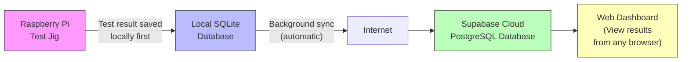
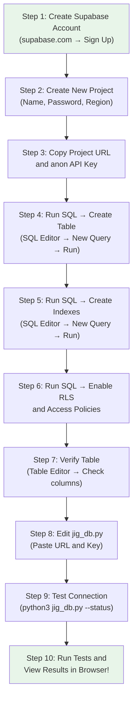

# Supabase Setup Guide — Step by Step

This guide walks you through setting up Supabase for the NEO Test Jig project. Everything is done through a web browser. No terminal commands needed on the Supabase side.

---

## What is Supabase?

Supabase is a free online database service. It gives you a PostgreSQL database in the cloud that your Raspberry Pi test jig can send test results to automatically. This way, you can view test results from anywhere with an internet connection.

### How It Works



> [!IMPORTANT]
> The test jig **always saves results locally first** in a SQLite file. If the internet goes down, tests continue without any interruption. When the internet comes back, all pending results are automatically uploaded to Supabase.

---

## Step 1: Create a Supabase Account

1. Open your web browser and go to: **[https://supabase.com](https://supabase.com)**
2. Click the **"Start your project"** button (or "Sign Up").
3. Sign up using your **GitHub account** or **email address**.
4. Verify your email if asked.

---

## Step 2: Create a New Project

1. After logging in, you will see the Supabase Dashboard.
2. Click **"New Project"**.
3. Fill in the details:
   - **Name:** `neo-test-jig` (or any name you like)
   - **Database Password:** Choose a strong password and **save it somewhere safe**. You will need this later.
   - **Region:** Pick the one closest to your location (e.g., `South Asia (Mumbai)` for India).
4. Click **"Create new project"**.
5. Wait 1–2 minutes while Supabase sets up your project.

---

## Step 3: Get Your Project URL and API Key

Once the project is ready:

1. In the left sidebar, click **"Project Settings"** (the gear icon ⚙️ at the bottom).
2. Click **"API"** under the "Configuration" section.
3. You will see two important values:

| What | Where to Find | Example |
|------|---------------|---------|
| **Project URL** | Under "Project URL" | `https://abcdefghijk.supabase.co` |
| **anon public key** | Under "Project API Keys" → `anon` `public` | `eyJhbGciOiJIUzI1NiIs...` (long string) |

4. **Copy both values** — you will need to paste them into the Raspberry Pi code later.

> [!TIP]
> The `anon` key is safe to use in your jig. It only allows inserting and reading data, nothing dangerous. The `service_role` key is more powerful — keep it secret and never share it.

---

## Step 4: Create the Database Table

This is where you run the SQL commands to create the table that stores test results.

1. In the left sidebar, click **"SQL Editor"** (looks like a code icon `</>`).
2. Click **"New Query"** (top left button).
3. **Copy and paste** the following SQL code into the editor:

```sql
-- ==============================================================================
--  STEP 4A: CREATE THE TEST RESULTS TABLE
-- ==============================================================================

CREATE TABLE IF NOT EXISTS public.jig_test_results (
    id BIGSERIAL PRIMARY KEY,
    sr BIGINT NOT NULL,
    jig_id TEXT NOT NULL,
    timestamp TEXT NOT NULL,
    mac TEXT NOT NULL,
    ficr_mac TEXT,
    rssi_dbm DOUBLE PRECISION,
    ble TEXT,
    imu_acctest TEXT,
    mic_result TEXT,
    led_delta_ma DOUBLE PRECISION,
    amber_led_delta_ma DOUBLE PRECISION,
    active_stream_ma DOUBLE PRECISION,
    V_charging DOUBLE PRECISION,
    sleep_current_ma DOUBLE PRECISION,
    client_firmware TEXT,
    result TEXT NOT NULL,
    comments TEXT,
    created_at TIMESTAMPTZ DEFAULT NOW(),

    -- This prevents duplicate records if the same batch is sent twice
    CONSTRAINT unique_jig_sr UNIQUE (jig_id, sr)
);
```

4. Click the **"Run"** button (or press `Ctrl+Enter`).
5. You should see a green message: **"Success. No rows returned."**

---

## Step 5: Create Performance Indexes

Indexes make database searches faster. Still in the SQL Editor:

1. Click **"New Query"** again.
2. **Copy and paste** this SQL:

```sql
-- ==============================================================================
--  STEP 5: CREATE INDEXES FOR FAST SEARCHES
-- ==============================================================================

CREATE INDEX IF NOT EXISTS idx_jig_results_mac 
    ON public.jig_test_results(mac);

CREATE INDEX IF NOT EXISTS idx_jig_results_result 
    ON public.jig_test_results(result);

CREATE INDEX IF NOT EXISTS idx_jig_results_timestamp 
    ON public.jig_test_results(timestamp DESC);

CREATE INDEX IF NOT EXISTS idx_jig_results_jig_id 
    ON public.jig_test_results(jig_id);
```

3. Click **"Run"**.
4. You should see: **"Success. No rows returned."**

---

## Step 6: Set Up Row Level Security (RLS)

RLS controls who can read and write to your table. This step allows the test jig to insert and read records.

1. Click **"New Query"** again.
2. **Copy and paste** this SQL:

```sql
-- ==============================================================================
--  STEP 6: ENABLE ROW LEVEL SECURITY AND ACCESS POLICIES
-- ==============================================================================

-- Turn on Row Level Security
ALTER TABLE public.jig_test_results ENABLE ROW LEVEL SECURITY;

-- Allow anyone with the API key to READ records
CREATE POLICY "Allow public read access"
ON public.jig_test_results
FOR SELECT
TO anon, authenticated
USING (true);

-- Allow anyone with the API key to INSERT (add) records
CREATE POLICY "Allow public insert and upsert"
ON public.jig_test_results
FOR INSERT
TO anon, authenticated
WITH CHECK (true);

-- Allow anyone with the API key to UPDATE records (needed for upserts)
CREATE POLICY "Allow public update for upserts"
ON public.jig_test_results
FOR UPDATE
TO anon, authenticated
USING (true)
WITH CHECK (true);
```

3. Click **"Run"**.
4. You should see: **"Success. No rows returned."**

---

## Step 7: Verify the Table Was Created

1. In the left sidebar, click **"Table Editor"** (looks like a grid icon).
2. You should see **`jig_test_results`** listed in the left panel.
3. Click on it — it should show an empty table with all the columns:
   `id`, `sr`, `jig_id`, `timestamp`, `mac`, `ficr_mac`, `rssi_dbm`, `ble`, `imu_acctest`, `mic_result`, `led_delta_ma`, `amber_led_delta_ma`, `active_stream_ma`, `V_charging`, `sleep_current_ma`, `client_firmware`, `result`, `comments`, `created_at`

> [!NOTE]
> The table is empty right now because no test results have been uploaded yet. Once the Raspberry Pi starts running tests, results will appear here automatically.

---

## Step 8: Configure the Raspberry Pi Code

Now go to the Raspberry Pi and edit the `jig_db.py` file:

1. Open `jig_db.py` in a text editor.
2. Find these lines near the top of the file (around line 39–41):

```python
SUPABASE_URL = "https://your-project-ref.supabase.co"
SUPABASE_KEY = "your-anon-or-service-role-key"
SUPABASE_TABLE = "jig_test_results"
```

3. Replace `SUPABASE_URL` with **your Project URL** from Step 3.
4. Replace `SUPABASE_KEY` with **your anon public key** from Step 3.
5. Make sure `SUPABASE_TABLE` is set to `"jig_test_results"` (it should already be).
6. Save the file.

### Enable Supabase Sync

In `jig_db.py`, make sure this line says `True`:

```python
ENABLE_SUPABASE = True
```

**OR** when running the test script, add the `--supabase` flag:

```bash
sudo python3 all_test_mux_remove.py --supabase
```

---

## Step 9: Test the Connection

On the Raspberry Pi, run:

```bash
python3 jig_db.py --status
```

You should see something like:

```
  JIG DATABASE STATUS
  ================================================
  Station ID      : JIG_01
  Local DB File   : /home/isc/Neo_test_jig/jig_results.db
  Total Records   : 0
  Synced (Cloud)  : 0
  Pending Sync    : 0
  Supabase Setup  : Configured
  ================================================
```

If it says **"Configured"**, your Supabase credentials are correctly set.

To force-sync any pending records:

```bash
python3 jig_db.py --sync
```

---

## Step 10: View Results in Your Browser

Once tests start running and results are synced:

1. Go to your Supabase Dashboard → **Table Editor** → **jig_test_results**.
2. You will see all test results in a spreadsheet-like view.
3. You can:
   - **Sort** by any column (click column headers)
   - **Filter** rows (e.g., show only `result = FAIL`)
   - **Search** for a specific MAC address
   - **Export** data as CSV

---

## Complete Setup Flow



---

## Troubleshooting

| Problem | Solution |
|---------|----------|
| "Supabase credentials not configured" | Check that `SUPABASE_URL` and `SUPABASE_KEY` in `jig_db.py` are correct. Make sure you removed the placeholder text. |
| "'requests' library is not available" | Run: `pip install requests` on the Raspberry Pi. |
| Records stuck in "Pending Sync" | Check your internet connection. The sync worker retries every 15 seconds automatically. Run `python3 jig_db.py --sync` to force a manual sync. |
| "HTTP 401 Unauthorized" | Your API key is wrong. Go to Supabase Dashboard → Settings → API and copy the `anon` key again. |
| "HTTP 404 Not Found" | The table name might be wrong. Make sure `SUPABASE_TABLE = "jig_test_results"` in `jig_db.py`. |
| "HTTP 409 Conflict" | Duplicate records. This is normal — the `unique_jig_sr` constraint prevents duplicates. Already-uploaded records are safe. |
| Table not showing in Table Editor | Make sure you ran the CREATE TABLE SQL in Step 4. Check the SQL Editor output for errors. |

---

## Updating an Existing Table (Migration)

If you already have a table from an older version of the project and need to add new columns:

```sql
-- Add V_charging column (if missing)
ALTER TABLE public.jig_test_results 
    ADD COLUMN IF NOT EXISTS "V_charging" DOUBLE PRECISION;

-- Add amber_led_delta_ma column (if missing)
ALTER TABLE public.jig_test_results 
    ADD COLUMN IF NOT EXISTS amber_led_delta_ma DOUBLE PRECISION;
```

To remove old columns that are no longer used:

```sql
-- Remove legacy voltage columns
ALTER TABLE public.jig_test_results DROP COLUMN IF EXISTS active_3v3;
ALTER TABLE public.jig_test_results DROP COLUMN IF EXISTS active_5v;
ALTER TABLE public.jig_test_results DROP COLUMN IF EXISTS active_vbat;
ALTER TABLE public.jig_test_results DROP COLUMN IF EXISTS sleep_3v3;
ALTER TABLE public.jig_test_results DROP COLUMN IF EXISTS sleep_5v;
ALTER TABLE public.jig_test_results DROP COLUMN IF EXISTS sleep_vbat;

-- Remove old mic and quiet columns
ALTER TABLE public.jig_test_results DROP COLUMN IF EXISTS mic_thd_pct;
ALTER TABLE public.jig_test_results DROP COLUMN IF EXISTS mic_snr_db;
ALTER TABLE public.jig_test_results DROP COLUMN IF EXISTS active_quiet_ma;
ALTER TABLE public.jig_test_results DROP COLUMN IF EXISTS active_quiet_db;
```

---

## Useful SQL Queries for Viewing Data

You can run these in the **SQL Editor** to get useful reports:

### See the last 20 test results
```sql
SELECT sr, timestamp, mac, result, comments
FROM jig_test_results
ORDER BY created_at DESC
LIMIT 20;
```

### Count total PASS and FAIL
```sql
SELECT result, COUNT(*) as count
FROM jig_test_results
GROUP BY result;
```

### Find all FAILed boards with reasons
```sql
SELECT timestamp, mac, comments
FROM jig_test_results
WHERE result = 'FAIL'
ORDER BY created_at DESC;
```

### Search for a specific MAC address
```sql
SELECT *
FROM jig_test_results
WHERE mac = 'AA:BB:CC:DD:EE:FF';
```

### Get results from a specific jig station
```sql
SELECT *
FROM jig_test_results
WHERE jig_id = 'JIG_01'
ORDER BY created_at DESC;
```

### Daily pass/fail summary
```sql
SELECT 
    LEFT(timestamp, 10) AS test_date,
    COUNT(*) FILTER (WHERE result = 'PASS') AS passed,
    COUNT(*) FILTER (WHERE result = 'FAIL') AS failed,
    COUNT(*) AS total
FROM jig_test_results
GROUP BY LEFT(timestamp, 10)
ORDER BY test_date DESC;
```
